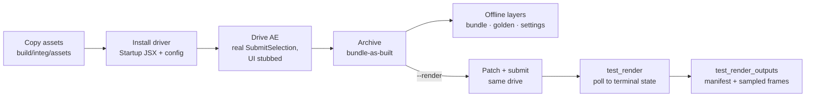

# After Effects submitter — integration tests

These tests drive the **real** Deadline Cloud for After Effects submitter in a real
After Effects, and optionally render the result on a real Deadline Cloud farm.

Nothing here reimplements the submitter. A Startup JSX re-drives the installed
`DeadlineCloudSubmitter*.jsx` headlessly, and pytest asserts on what it produces.

## Layers

One cached AE drive (~30 s) per case feeds every layer.

| Test | Proves | Runs |
|---|---|---|
| `test_bundle_generation` | The bundle passes `openjd check`; one step per comp; frame ranges match the comps (and `expect_frames`); output names match AE's; conda and asset references are right; no unexpected submitter alerts. | always |
| `test_bundle_matches_golden` | The bundle matches `test_cases/<case>/expected/job_bundle/` after normalization. | always |
| `test_job_settings` | Each `settings` value reached the bundle; unset settings kept the submitter's defaults. | always |
| `test_render` | The job reaches the expected terminal state on the farm. | `--render` |
| `test_render_outputs` | Every expected output file exists; sampled frames decode, differ, and (with `frame_code`) carry their own frame number; the tasks cover `expect_frames`. | `--render` |

## Cases

18 cases, T05–T23. What each covers, its settings, expectations, steps and outputs,
and which layers run for it: [`test_cases/README.md`](test_cases/README.md).

A case in `cases.KNOWN_DEFECTS` runs as a strict xfail limited to its checks against
what was authored in AE (frames, output names): any other failure still fails, and a
fix turns the suite red until the entry is removed.

## How it works



1. `driver.install_driver()` copies `scripts/DeadlineCloudAutoSubmit.jsx` into AE's
   `Scripts/Startup`.
2. The asset tree is copied to `build/integ/assets/`. Drives open the copy, so the
   committed projects never change.
3. `driver.run_submitter()` writes `~/.deadline/headless_submit_config.json` and
   launches AE. The JSX opens the project, clears sticky submitter settings, runs the
   real submitter with its UI stubbed, and writes a result file plus a `.done` marker.
4. The harness waits for the marker, stops AE, and archives the bundle.
5. With `--render`, the bundle is patched (description, task timeout, output dir under
   `build/`) and submitted during the same drive. The render tests poll the job and
   sample its outputs.

The submitter UI is stubbed, so the Submit button, docking and dialogs are not tested.

## Prerequisites

- After Effects 2025 or 2026, signed in to Creative Cloud.
- Fonts: [Lato](https://fonts.google.com/specimen/Lato) (`Lato-Regular`, SIL OFL)
  installed, and Komet activated from Adobe Fonts.
- In AE: *Preferences (macOS: Settings) > Scripting & Expressions > Allow Scripts to
  Write Files and Access Network* on.
- The submitter installed in AE's user or system **ScriptUI Panels** folder:
  - macOS: `~/Library/Preferences/Adobe/After Effects/<ver>/Scripts/ScriptUI Panels/`
    or `/Applications/Adobe After Effects <year>/Scripts/ScriptUI Panels/`
  - Windows: `%APPDATA%\Adobe\After Effects\<ver>\Scripts\ScriptUI Panels\`
    or `C:\Program Files\Adobe\Adobe After Effects <year>\Support Files\Scripts\ScriptUI Panels\`

  A user install wins. `AE_SUBMITTER_PATH` points at any other copy. To test your
  branch, install `dist/DeadlineCloudSubmitter.jsx` and `dist/DeadlineCloudSubmitter_Assets/`.
- [hatch](https://hatch.pypa.io/).
- Render only: the `deadline` CLI with a default farm and queue (`deadline config show`)
  and valid credentials. The queue needs job attachments.
- An unlocked desktop session. AE can't finish a drive while the screen is locked.

### What a run changes on your machine

To launch AE unattended, the harness edits your **real** AE preferences before each
launch. Run it on a dedicated test machine, or save your work first:

- **Deletes** AE's `Adobe After Effects Auto-Save Recovery/` and `CrashRecovery/`
  folders, crash markers, and `*.aepcrash` files, so the crash-repair dialog can't
  block a launch. Unsaved recovery data is lost.
- Sets `AE.DebugShowPreviousCrashWarning` to `false` in `Debug Database.txt`.
- On macOS, clears AE's `AppStates` defaults.
- Turns off Adobe's in-app feedback survey for the AE version under test.
- Installs a Startup script while the suite runs, and removes it afterwards.

## Running

```bash
# Offline layers. No farm.
hatch run integ:test

# All layers, rendering on the default farm.
hatch run integ:test-render

# Pick the AE year (default 2026), or one case.
AE_VERSION=2025 hatch run integ:test -k T17
```

Results: pytest output, plus JUnit XML at `build/integ/results.xml`. Each case writes
`build/integ-artifacts/<id>-<slug>/` with the bundle as built, the bundle as
submitted, and the submit, wait and outputs results. Downloaded frames are kept only
for failing cases (`--keep-outputs` keeps all).

### Options

| Var / flag | Default | Meaning |
|---|---|---|
| `AE_VERSION` / `--ae-version` | `2026` | AE year to drive. |
| `AE_EXECUTABLE` | from year | AE executable path. |
| `AE_SUBMITTER_PATH` | user, then system ScriptUI Panels | Submitter under test. |
| `AE_TEST_ASSETS` | `test/integ/aep_test_assets` | Source asset root (`projects/ae<year>/`). |
| `DEADLINE_CLI` | `deadline` | Deadline CLI. |
| `--render` / `AE_RUN_RENDER=1` | off | Enable the render layers. |
| `--strict-environment` / `AE_STRICT_ENVIRONMENT=1` | off | Fail, not skip, on missing AE/submitter/assets or an unreachable farm. |
| `--keep-outputs` | off | Keep downloaded frames for passing cases. |
| `AE_UPDATE_GOLDENS=1` | off | Rewrite the goldens from this run. Review the diff. |
| `AE_JOB_WAIT_TIMEOUT` | `1200` | Per-job poll budget (s). |
| `AE_JOB_SUBMIT_TIMEOUT` | `900` | Upper bound for `deadline bundle submit` (s). |
| `AE_JOB_TASK_TIMEOUT` | `3600` | Task timeout stamped on cases that set none (s). |
| `AE_JOB_MAX_RETRIES` | `3` | Retries per task. |

## Adding a case

1. Add a builder to `aep_test_assets/scripts/build_test_projects.jsx` and rebuild only
   that id for each AE year:
   `AE_VERSION=2025 hatch run integ:python test/integ/aep_test_assets/scripts/run_build.py T24`.
2. Add `test_cases/<id>_<slug>/case.json`:

   ```json
   {
     "id": "T17",
     "name": "Multi-comp submit",
     "aep_slug": "multicomp",
     "settings": {},
     "expect": "SUCCEEDED",
     "render": true
   }
   ```

   `settings` are applied by the driver JSX. `expect` is the terminal job status.
   Optional: `expect_failure_message`, `expect_alerts`, `max_retries`, `ae_run_timeout`,
   `expect_frames`, `frame_code`
   (see `harness/cases.py`).
3. Write its golden with `AE_UPDATE_GOLDENS=1 hatch run integ:test -k <id>`, and
   review it.
4. Add a coverage row and a section to `test_cases/README.md`. `test_cases_documented`
   fails until the case is listed there.

## Assets

`aep_test_assets/` holds the projects and the footage they import:

- `projects/ae<year>/<id>_<slug>_ae<year>_v<version>.aep`. `<version>` is
  `asset_version` in `aep_test_assets/manifest.json`.
- `source_assets/`: video, audio, still, PNG sequence. Regenerate with
  `aep_test_assets/scripts/generate_source_assets.py` (needs ffmpeg and Pillow).
- `scripts/build_test_projects.jsx` builds the projects; `scripts/run_build.py` runs it
  headlessly. Pass only the ids you changed: AE rewrites every project it saves.

AE records the saving machine's name and home-directory paths (with the username) in
each `.aep`. `run_build.py` replaces both with placeholders, and
`test/unit/test_integ_asset_hygiene.py` fails if a committed project still carries
either.
